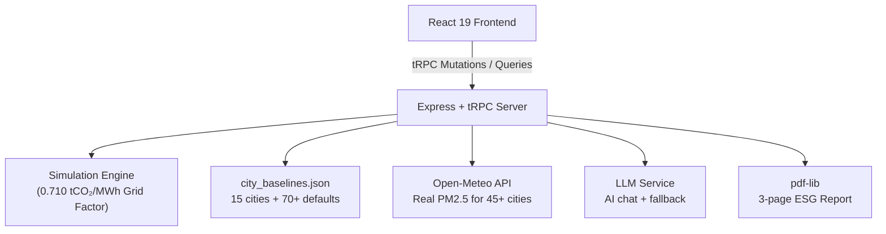

# 🌿 EcoPolicy AI — Urban Climate Decision Intelligence Platform

> Simulate, optimize, and visualize the environmental impact of green policy interventions across 85+ Indian cities — with live AQI data, AI-powered recommendations, and professional PDF ESG reports.


---

## 🔗 Live Demo

> **[🚀 Launch EcoPolicy AI](https://ecopolicy-ai.onrender.com)** ← *(update after deploy)*

---

## 📸 Screenshots

| Dashboard | Policy Optimizer | PDF Report |
|-----------|-----------------|------------|
| Select city, move sliders, run simulation | AI recommends best lever combination | Download 3-page ESG brief |

---

## 🎯 What Is This?

**EcoPolicy AI** is a full-stack web application that lets city planners, ESG analysts, students, and researchers **simulate "what-if" climate policy scenarios** for Indian cities.

You pick a city → adjust 5 policy sliders → click **Run Simulation** → instantly see how CO₂ emissions, Air Quality (AQI), Electricity Demand, and a Green Sustainability Score would change.

Think of it as a **flight simulator for urban climate policy** — test decisions safely before they affect real budgets and real people.

---

## ✨ Key Features

### 🏙️ 85+ Indian Cities
- 15 major cities with detailed baselines (Delhi, Mumbai, Bengaluru, Chennai, Kolkata, Hyderabad, Ahmedabad, Surat, Pune, Jaipur, Lucknow, Kanpur, Nagpur, Indore, Agra)
- 70+ additional cities with standard planning baselines
- Add any custom city — automatic fallback baseline applied
- Duplicate city prevention with smart redirect

### 📊 5 Policy Levers (0–100%)
| Lever | Impact |
|-------|--------|
| 🚗 EV Adoption | Biggest CO₂ reducer (9× weight) |
| ☀️ Solar Energy | Reduces grid electricity (10× weight) |
| 🌳 Urban Forestry | Improves AQI + Green Score |
| ♻️ Plastic Recycling | Reduces landfill emissions |
| 🚌 Public Transit | Second biggest CO₂ reducer (7× weight) |

### 🌬️ Live AQI Integration
- Real-time PM2.5 data from **Open-Meteo API** (no key needed) for 45+ cities
- Fallback to **WAQI API** for smaller cities
- Converted to India AQI scale (Good → Severe)
- 15-minute cache per city
- Clearly labeled: live estimate vs planning baseline

### 🤖 AI Policy Optimizer
- Select a goal: *Reduce CO₂ / Improve AQI / Reduce Energy / Maximize Green Score / Balanced*
- Runs **161,051-combination grid search** to find optimal lever settings
- Shows expected % improvement for all 4 metrics
- "Apply These Levers" auto-runs the simulation instantly

### 💬 AI Policy Assistant
- Multi-turn chat powered by LLM
- Knows your current simulation context (CO₂, AQI, Green Score)
- 4 suggested prompts to get started
- Deterministic fallback if LLM is unavailable

### 📈 6 Analytics Panels
1. **Overview** — Bar chart + Radar chart (Baseline vs Simulated)
2. **Projections** — 2026–2040 CO₂ and AQI trajectory line charts
3. **Risk & Score** — Climate Risk gauge (0–100) + Policy Impact Score ring
4. **Economic** — CAPEX, OPEX, savings, green jobs in ₹ Crore + SDG progress bars
5. **Feature Importance** — Which lever contributed most to each metric
6. **Scenarios** — Save, load, delete, compare up to 4 scenarios side-by-side

### 📄 PDF ESG Report
- Professional 3-page downloadable policy brief
- Page 1: KPI snapshot, executive interpretation, data confidence
- Page 2: Policy levers, progress bars, 3-phase implementation timeline
- Page 3: Full data provenance, methodology, decision safeguards

---

## 🛠️ Technology Stack

| Layer | Technology |
|-------|-----------|
| Frontend | React 19, TypeScript, Tailwind CSS v4 |
| UI Components | shadcn/ui, Radix UI |
| Charts | Recharts (bar, radar, line) |
| Routing | Wouter |
| API Layer | tRPC v11 + Zod validation |
| Backend | Node.js, Express |
| PDF Generation | pdf-lib (WinAnsi-safe encoding) |
| AI / LLM | Forge API with deterministic fallback |
| Live AQI | Open-Meteo Air Quality API + WAQI fallback |
| Database | Drizzle ORM + MySQL |
| Build | Vite 7, esbuild, tsx |



---

## 🚀 Local Setup

### Prerequisites
- Node.js v18+
- npm or pnpm

### Installation

```bash
# 1. Clone the repo
git clone https://github.com/drashti8175/ecopolicy-ai.git
cd ecopolicy-ai

# 2. Install dependencies
npm install

# 3. Set up environment variables
cp .env.example .env
# Edit .env — see variables below

# 4. Start development server
npm run dev
```

Open **http://localhost:5000** in your browser.

### Environment Variables

```env
# Required
PORT=5000
NODE_ENV=development

# Optional — AI chat (works without it, uses fallback)
BUILT_IN_FORGE_API_KEY=your_key_here

# Optional — extra AQI coverage for smaller cities
# Get free key at: https://aqicn.org/data-platform/token/
WAQI_API_KEY=your_key_here

# Optional — live CPCB station AQI (official India data)
DATA_GOV_IN_API_KEY=your_key_here
DATA_GOV_IN_RESOURCE_ID=your_resource_id
```

### Build for Production

```bash
npm run build
npm start
```

---

## 📐 Simulation Model

### How the Math Works

```
delta = slider_value - city_baseline_value

CO₂_predicted  = baseline_CO₂  - (Δev×9) - (Δsolar×4) - (Δtransport×7) - (Δtrees×3) - (Δrecycling×1)
AQI_predicted  = baseline_AQI  - (Δev×3.5) - (Δsolar×0.5) - (Δtransport×2.5) - (Δtrees×1.8) - (Δrecycling×0.3)
Elec_predicted = baseline_Elec - (Δsolar×10) + (Δev×3)   ← EV increases grid load
GreenScore     = baseline_GS   + (Δev×0.7) + (Δsolar×0.6) + (Δtrees×0.5) + (Δrecycling×0.35) + (Δtransport×0.6)
```

### Data Sources

| Data | Source |
|------|--------|
| City baselines | Smart Cities Mission reports, CPCB annual bulletins, World Bank indicators |
| Grid emission factor | CEA National Electricity Plan — **0.710 tCO₂/MWh** |
| Tree sequestration | Urban forestry literature — **0.021 tCO₂/tree/year** |
| Live AQI | Open-Meteo Air Quality API (real-time PM2.5 model estimate) |
| Fallback AQI | WAQI API (free tier) |

> ⚠️ **Transparency note:** Simulation outputs are scenario projections for comparative policy analysis, not deterministic forecasts or observed outcomes.

---

## 🎯 UN Sustainable Development Goals

| SDG | How This Project Contributes |
|-----|------------------------------|
| **Goal 7** — Affordable and Clean Energy | Models solar adoption and grid electricity demand reduction |
| **Goal 11** — Sustainable Cities and Communities | Evaluates AQI, public transit, and urban green infrastructure |
| **Goal 13** — Climate Action | Quantifies CO₂ emission reductions across urban policy scenarios |

---

## 📁 Project Structure

```
ecopolicy-ai/
├── client/src/
│   ├── pages/
│   │   ├── Landing.tsx          # Home page
│   │   └── Dashboard.tsx        # Main simulator
│   ├── components/
│   │   ├── OptimizePanel.tsx    # AI grid-search optimizer
│   │   ├── EconomicPanel.tsx    # Cost & jobs estimator
│   │   ├── ProjectionPanel.tsx  # 2026–2040 forecast charts
│   │   ├── ClimateRiskScore.tsx # Risk gauge
│   │   ├── FeatureImportance.tsx# Lever contribution bars
│   │   ├── PolicyImpactScore.tsx# Overall score ring
│   │   ├── AIPolicyAssistant.tsx# LLM chat interface
│   │   ├── ScenarioManager.tsx  # Save/compare scenarios
│   │   └── DataMethodology.tsx  # Transparent data sources
│   └── App.tsx
├── server/
│   ├── simulation.ts            # Core simulation engine + live AQI
│   ├── simulation_llm.ts        # AI chat and explanation endpoints
│   ├── pdf_report.ts            # PDF ESG report generator
│   └── routers.ts               # tRPC router registration
├── data/
│   └── city_baselines.json      # 15-city baseline dataset
└── .env.example
```

---

## 🤝 Contributing

Pull requests are welcome. For major changes, please open an issue first.

1. Fork the repo
2. Create your feature branch (`git checkout -b feature/amazing-feature`)
3. Commit your changes (`git commit -m 'Add amazing feature'`)
4. Push to the branch (`git push origin feature/amazing-feature`)
5. Open a Pull Request

---

## 👩‍💻 Author

**Drashti** — [GitHub](https://github.com/drashti8175) · [LinkedIn](https://linkedin.com/in/drashti8175)

---

## 📄 License

MIT License — see [LICENSE](LICENSE) for details.

---

<div align="center">
  <strong>Built with ❤️ for sustainable Indian cities</strong><br/>
  <sub>EcoPolicy AI — scenario intelligence for transparent, people-centred urban climate planning</sub>
</div>
